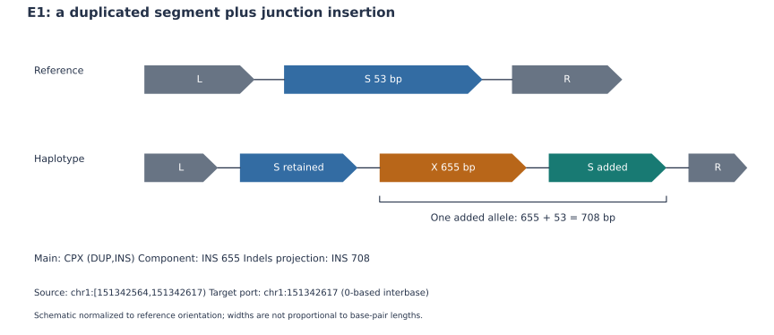
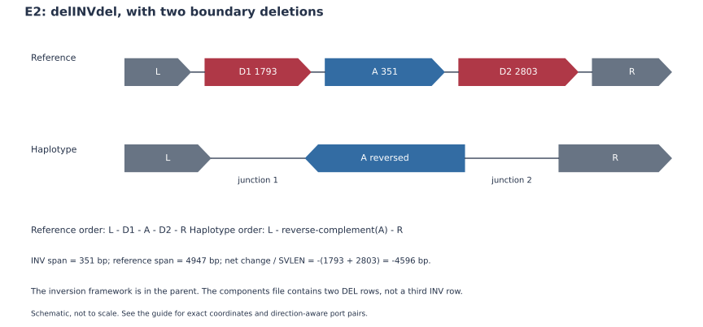
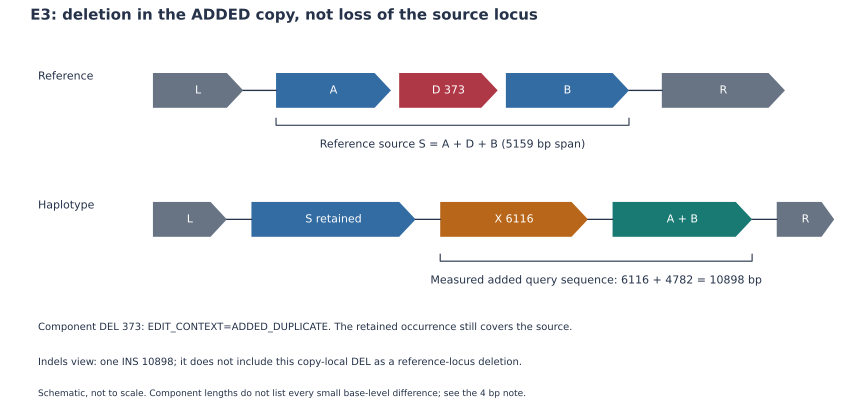

# Reading CSV output: AsmSV 1.3.0 worked examples

[中文](CSV_EXAMPLES_ZH.md) · [Output fields and coordinates](OUTPUT_FORMAT.md) · [Data and inspection script](../examples/csv/README.md)

Five real report units and one incomplete region illustrate how to read results. The subset preserves data rows from frozen HG002-to-CHM13v2.0 calls and was checked with the current exporter; whole-genome detection was not rerun. These are actual caller outputs, not independently validated biological truth.

## 1. Start at the main record and follow its links

| Question | File and fields |
| --- | --- |
| What structure was reported? | Main `calls.vcf`: ID, SVTYPE, composition, source/target, FILTER, GT/FT/PS |
| Which edits belong to it? | `calls.vcf.components.vcf`: EVENT/PARENT_EVENT, EDIT_CONTEXT |
| What traverses the assembly, and which ports connect? | `calls.vcf.events.jsonl`: VCF_RECORD, EVENT_ALIASES, CONTIG event/context/atoms |
| Which view supports reference INS/DEL comparison? | `calls.vcf.indels.vcf`: reference-locus projections |
| Which breakends are paired and oriented? | Optional `calls.vcf.junctions.vcf`: BND ALT, MATEID, parent links |
| What remains incomplete? | `calls.vcf.regions.jsonl` / `.regions.bed`: boundaries, members, reasons, local joins |

A component's EVENT points to the main record ID. Minimal main records may omit self-referencing EVENT. PARENT_EVENT can preserve multiple parents, CONTEXT_ID identifies an interpretation context, and MATEID pairs one adjacency. These views describe shared evidence; concatenating and counting every row duplicates alleles.

Broad `--scope csv` includes CPX, native inverted/dispersed DUP and a separate DELINS replacement stratum. `--scope cpx` includes CPX only. Ordinary tandem DUP, basic INS/DEL/INV, standalone BND/TRA and single-source templated INS of unknown retention do not become CSVs through proximity. `ASMSV_CSV_CLASS` exists only in the derived export; original SVTYPE is retained.

## 2. Run the small supplied example

Run from the repository root containing `pyproject.toml`, `scripts/` and `examples/`, using Python 3.10+.

~~~bash
python scripts/export_cpx.py \
  --vcf examples/csv/data/calls.vcf \
  --scope csv --out-prefix /tmp/asmsv-csv-demo/calls.csv
~~~

Open `/tmp/asmsv-csv-demo/calls.csv.html` in a browser. JSONL and a VERIX endpoint VCF are also produced. Expect **5 report units, 4 with linkable structural evidence**. The standalone DELINS diagram can carry VCF_ONLY_LAYOUT: its display uses VCF fields, which does not mean the original sequence evidence is absent.

~~~bash
python scripts/export_cpx.py \
  --vcf examples/csv/data/calls.vcf \
  --scope cpx --out-prefix /tmp/asmsv-csv-demo/calls.cpx
~~~

CPX-only produces **3 reports**. U1 is outside both export populations. If outputs already exist, choose a new prefix or explicitly add `--force`.

For your own output after installation:

~~~bash
asmSV-cpx --vcf calls.vcf --scope csv --out-prefix calls.csv
~~~

CPX summaries need the component companion. Structural JSONL is read automatically if available. Renamed companions can be supplied with `--components` and `--events`; `--no-events` skips structural JSONL. Original FILTER values are retained by default; `--pass-only` restricts parent/report rows. Browser REF/ALT cartoons omit small differences, are not to scale and do not replace full sequence reconstruction.

## 3. Five real examples

| Example | Main record ID | Native type / export family |
| --- | --- | --- |
| E1 | `EVENT.fec02c216e5187917e8344ee` | CPX / DUP_WITH_EDITS |
| E2 | `EVENT.28d094bb75442489a57a3cda` | CPX / INV_WITH_EDITS |
| E3 | `EVENT.47c90f8bd1c8324ff795918f` | CPX / DUP_WITH_EDITS |
| E4 | `EVENT.ee56f9532e91fd95587bd829` | DUP / INVERTED_DUPLICATION |
| E5 | `SV.DELINS.000004` | DELINS / REPLACEMENT |

### E1: insertion at a duplication junction

The chr1 main record has `POS=151342564;END=151342617;SVLEN=708` and composition `DUP,INS`. The source is 53 bp. Component `SV.INS.000109` is a 655-bp insertion with `EDIT_CONTEXT=DUPLICATION_JUNCTION`. The reference indels view represents the entire added allele as a 708-bp INS:

$$
53+655=708.
$$

The parent CPX, 655-bp component and 708-bp projection are not three independent events. An insertion occupies a target port; CPX_INTERVALS need not contain a reference interval matching its length. Parent GT is `0|1:PS=2811`, while the component has `1/.:FT=NONREFERENCE_COMPONENT`. That difference does not invalidate ownership.

### E2: inversion with two flanking deletions

These are field excerpts, wrapped for reading rather than valid input VCF lines:

~~~text
ID=EVENT.28d094bb75442489a57a3cda
CHROM=chr5;POS=8195511;END=8200458;SVTYPE=CPX;SVLEN=-4596
CPX_TYPE=delINVdel;CPX_COMPONENTS=INV,DEL,DEL
CPX_INTERVALS=INV_chr5:8197305-8197655,
              DEL_chr5:8195512-8197304,DEL_chr5:8197656-8200458
~~~

| Part | Length | Component/framework |
| --- | ---: | --- |
| Left DEL | 1793 bp | `SV.DEL.000002` |
| INV | 351 bp | Parent CPX and JSON framework; no additional INV component required |
| Right DEL | 2803 bp | `SV.DEL.000003` |

The full reference span is 4947 bp, whereas net change is −4596 bp. CPX_COMPONENTS is not an ALT segment order.

JSON connects `8195511_R ↔ 8197655_R` and `8197304_L ↔ 8200458_L`. Also inspect `target_strand=-` and source strand `+`: the source is inverted relative to its target framework. A source plus sign alone cannot establish absence of inversion.

Parent GT is `0/1;FT=NO_REFERENCE_SUPPORT`. The left DEL also carries FT, while the right DEL has `1|0;PS=2294`. The parent and components are genotyped against their own evidence requirements; their GT strings need not match.

### E3: the deletion affects the added copy

The chr3 main record has `CPX_COMPONENTS=DUP,DEL,INS;SVLEN=10898`:

| Component ID | Length | EDIT_CONTEXT |
| --- | ---: | --- |
| `SV.DEL.000001` | −373 bp | ADDED_DUPLICATE |
| `SV.INS.000485` | 6116 bp | DUPLICATION_JUNCTION |

The DEL identifies the source-template portion missing from the added copy. It does not establish deletion at the retained donor locus. The indels view contains the whole 10898-bp INS projection and excludes this copy-local DEL as a reference-locus deletion.

Diagnostic evidence gives a template span of 5159 bp and measured added-copy traversal of 4782 bp:

$$
4782+6116=10898.
$$

Do not substitute `5159−373+6116` for measured query length: it differs by 4 bp because SV components are not a complete small-variant inventory. Parent GT is `0/1;FT=NO_REFERENCE_SUPPORT`; both components have `1/.:FT=NONREFERENCE_COMPONENT`.

### E4: an inverted copy can remain native DUP

The chr3 main record has `POS=432175;END=432221;SVLEN=46;DUP_TYPE=piDUP_RF` and target port 432175. It describes an added inverted traversal of the 46-bp source. It enters broad CSV while retaining `SVTYPE=DUP`; no independent INV is invented.

Its original INS basis, component `SV.INS.000415`, retains POS 432164 and its original sequence. DUP confirmation uses a port shifted through 11 equivalent anchor bases; JSON records `INS_ANCHOR_SHIFT`. This is checked allele normalization, not a universal +1 conversion or arbitrary breakpoint movement. The 46-bp copy is below a common 50-bp benchmark cutoff, so type selection and size filtering must remain separate.

### E5: zero net length can still describe replacement

Main record `SV.DELINS.000004` is on chr1, `POS=139844627;END=139844753`:

~~~text
SVTYPE=DELINS;INS_LEN=126;DEL_LEN=126;SVLEN=0
GT:FT = 0/1:NO_REFERENCE_SUPPORT
~~~

The 126-bp reference sequence is replaced by another 126 bp. Filtering only on `abs(SVLEN)` would lose the change. DELINS is a main report; it need not have separate INS/DEL component rows and is outside the INS/DEL-only indels projection.

## 4. Inspect an event or incomplete region

~~~bash
python examples/csv/inspect_csv.py \
  --vcf examples/csv/data/calls.vcf \
  --event EVENT.47c90f8bd1c8324ff795918f

# Full context/atom excerpts; standalone DELINS is traced through ATOM_ID
python examples/csv/inspect_csv.py \
  --vcf examples/csv/data/calls.vcf \
  --event SV.DELINS.000004 --details
~~~

The script reads existing files and writes a JSON inspection summary, separating parents, components, indels and BND. Replace `--vcf` to inspect your same-prefix companion files. Its event query covers the CSV population; basic INV and other excluded classes are outside this query interface.

Incomplete example **U1**:

~~~bash
python examples/csv/inspect_csv.py \
  --vcf examples/csv/data/calls.vcf \
  --region REGION.440fcc21c1282d2a732619c3
~~~

Expect `resolution=PARTIAL`, a CRR label and reason `TARGET_REPLACEMENT_WITH_SOURCE_PATH`, with `canonical_event_ids=[]`, `counts_as_variant=false` and `genotype=null`. Two of three retained joins are noncollinear; another transition is rejected as `TWO_SIDED_RESIDUAL`. Its six PARTIAL BND records form three mate pairs, not six CSVs. The region is inspected through regions/junction files rather than the CSV browser.

## 5. Keep coordinates, confidence and cartoons distinct

| Field/state | Interpretation |
| --- | --- |
| SOURCE_START/END and JSON intervals | 0-based half-open; length=end−start |
| TARGET_POS and JSON junction positions | 0-based interbase ports |
| CPX_INTERVALS | 1-based inclusive; INV 8197305–8197655 is 351 bp |
| VCF POS | Type-dependent anchoring; no universal ±1 conversion |
| EDIT_CONTEXT | REFERENCE, ADDED_DUPLICATE or DUPLICATION_JUNCTION defines edit scope |
| FILTER=PASS versus FORMAT/FT | Record filtering and sample genotype evidence are separate; PASS can coexist with NO_REFERENCE_SUPPORT |
| RESOLVED | Accepted selected-path SV-scale template, not nucleotide completeness or independent truth |
| CPX_INTERVALS / component list / BKPS | Interval/composition/endpoint summaries, not complete ordered ALT paths |

For unfamiliar structures, inspect query traversal, retained source, orientation, edge pairing and sequence. Current templates do not guarantee general multisource, arbitrary nesting, reciprocal exchange or repeat-ambiguous resolution. Native VCF, browser cartoons, endpoint exports and a complete allele sequence provide different levels of information. The [output contract](OUTPUT_FORMAT.md) remains the field/option reference.

## Full insertion payloads and source-loss/target-gain links

The existing HG002 examples on this page are frozen older output. New1.3.0 calls also provide .sequences.fa: SEQID, SEQLEN, SEQSHA256 and SEQFILE identify the FASTA payload, length, hash and filename. Known payloads≥10 kb are retained. Assembly N/IUPAC remains uncertainty.

Inspect .indels.vcf for reference changes. To assess TRA topology, enable --junction-vcf and inspect the three oriented joins rather than a target INS alone. RELOCATION_ID links independently observed same-haplotype donor DEL and target INS. Find record_kind=RELOCATION in .events.jsonl and inspect atom links, original donor, independent boundary-shift proofs, hashes and HAPLOTYPE_DELETION_CANDIDATES scope. Unknown retention does not establish DUP; a source-loss/target-gain relation is neither a unique historical mechanism nor an extra CSV count.

Optional --tandem-target-indels writes a separate .target_indels.vcf, placing exactly equivalent tandem INS at the parent target. Do not pool it with default indels. Equivalent tandem ports can be farther apart than a benchmark distance window; declare the view and use compatible truth/query representations.
