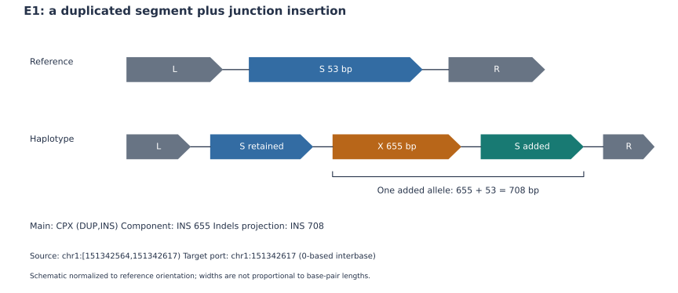
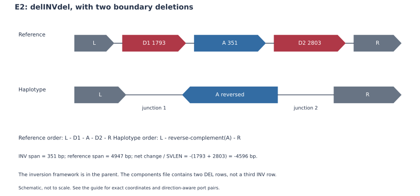
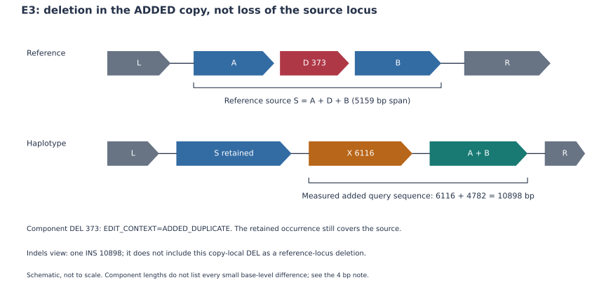

# CSV 输出阅读示例：AsmSV 1.3.0

[English](CSV_EXAMPLES_EN.md) · [输出字段与坐标](OUTPUT_FORMAT.md) · [示例数据与读取脚本](../examples/csv/README.md)

本页用五个真实报告单元和一个未解析区域说明结果读法。数据摘自 HG002 对 CHM13v2.0 的冻结调用，保留原始数据行，随后用当前导出器复查；本次没有重跑全基因组调用。这些是程序输出示例，不是独立验证的生物学真值。

## 1. 从主记录开始，沿关联查看

| 想知道什么 | 查看位置 |
| --- | --- |
| 报告了什么结构 | 主 `calls.vcf`：ID、SVTYPE、组成、来源/目标、FILTER、GT/FT/PS |
| 哪些编辑属于这个结构 | `calls.vcf.components.vcf`：EVENT/PARENT_EVENT、EDIT_CONTEXT |
| 在组装上怎样遍历、谁和谁相连 | `calls.vcf.events.jsonl`：VCF_RECORD、EVENT_ALIASES、CONTIG 的 event/context/atoms |
| 与参考 INS/DEL 集比较 | `calls.vcf.indels.vcf`：参考原位投影 |
| 连接方向和配对 | 可选 `calls.vcf.junctions.vcf`：BND ALT、MATEID、父关联 |
| 哪部分没有完整解释 | `calls.vcf.regions.jsonl` / `.regions.bed`：边界、成员、原因与局部连接 |

组件的 EVENT 指向主 VCF 的 ID。minimal 主行可能省略自指 EVENT；不要据此判定没有关联。PARENT_EVENT 可保留多父关系；CONTEXT_ID 只标识候选解释上下文，MATEID 只配对一条连接。几个视图描述同一证据，不能拼接后相加计数。

广义 `--scope csv` 包括 CPX、原生倒向/分散 DUP 和单列的 DELINS 替换；`--scope cpx` 仅含 CPX。普通串联 DUP、基本 INS/DEL/INV、单独 BND/TRA 和保留未知的单来源模板 INS 不因邻近就成为 CSV。`ASMSV_CSV_CLASS` 仅存在于派生导出，原始 SVTYPE 不改变。

## 2. 先运行随附的小示例

使用 Python 3.10+ 安装 AsmSV 后，从包含 `pyproject.toml` 和 `examples/` 的仓库根目录执行以下命令。

~~~bash
asmSV-cpx \
  --vcf examples/csv/data/calls.vcf \
  --scope csv --out-prefix /tmp/asmsv-csv-demo/calls.csv
~~~

在浏览器打开 `/tmp/asmsv-csv-demo/calls.csv.html`；同时生成 JSONL 和 VERIX 端点视图。预期为 **5 个报告单元、4 个带可关联的结构证据**。独立 DELINS 的浏览图可标为 VCF_ONLY_LAYOUT；这说明该展示使用 VCF 字段，而非该位点不存在原始序列证据。

~~~bash
asmSV-cpx \
  --vcf examples/csv/data/calls.vcf \
  --scope cpx --out-prefix /tmp/asmsv-csv-demo/calls.cpx
~~~

CPX-only 预期为 **3 个**。示例 U1 不进入两种 CSV 导出范围。重复运行时若输出已存在，换前缀或显式加 `--force`。

安装后对自己的结果运行：

~~~bash
asmSV-cpx --vcf calls.vcf --scope csv --out-prefix calls.csv
~~~

CPX 汇总需要组件文件；结构 JSONL 存在时自动读取。文件改名可加 `--components`、`--events`；`--no-events` 仅跳过结构 JSONL。默认保留原始 FILTER，`--pass-only` 只限制父/报告行。浏览器中的 REF/ALT 是省略小差异、非按比例的结构示意，不替代完整序列重建。

## 3. 五个真实例子

| 示例 | 主记录 ID | 主类型／导出家族 |
| --- | --- | --- |
| E1 | `EVENT.fec02c216e5187917e8344ee` | CPX / DUP_WITH_EDITS |
| E2 | `EVENT.28d094bb75442489a57a3cda` | CPX / INV_WITH_EDITS |
| E3 | `EVENT.47c90f8bd1c8324ff795918f` | CPX / DUP_WITH_EDITS |
| E4 | `EVENT.ee56f9532e91fd95587bd829` | DUP / INVERTED_DUPLICATION |
| E5 | `SV.DELINS.000004` | DELINS / REPLACEMENT |

### E1：复制连接处有插入

主行在 chr1，`POS=151342564;END=151342617;SVLEN=708`，组成 `DUP,INS`。来源为53 bp；组件 `SV.INS.000109` 为连接处655-bp INS，`EDIT_CONTEXT=DUPLICATION_JUNCTION`。参考 indels 视图则给出整个新增等位的708-bp INS：

$$
53+655=708.
$$

父CPX、655-bp组件与708-bp投影不应计为三个独立事件。INS位于目标端口，不必在CPX_INTERVALS中占一个与其长度相等的参考区间。父GT为`0|1:PS=2811`，组件为`1/.:FT=NONREFERENCE_COMPONENT`；这不是父归属冲突。

### E2：倒位及两侧删除

主行字段摘录如下，换行仅供阅读：

~~~text
ID=EVENT.28d094bb75442489a57a3cda
CHROM=chr5;POS=8195511;END=8200458;SVTYPE=CPX;SVLEN=-4596
CPX_TYPE=delINVdel;CPX_COMPONENTS=INV,DEL,DEL
CPX_INTERVALS=INV_chr5:8197305-8197655,
              DEL_chr5:8195512-8197304,DEL_chr5:8197656-8200458
~~~

| 组成 | 长度 | 组件/框架 |
| --- | ---: | --- |
| 左DEL | 1793 bp | `SV.DEL.000002` |
| INV | 351 bp | 主CPX及JSON框架，无需另一条INV组件 |
| 右DEL | 2803 bp | `SV.DEL.000003` |

参考整体跨度为4947 bp；净长度变化是−4596 bp。`CPX_COMPONENTS` 不是ALT的片段顺序。

JSON中两个端口对为 `8195511_R ↔ 8197655_R` 和 `8197304_L ↔ 8200458_L`。还应核对 context 的 `target_strand=-` 与 source 的 `+`：相对于目标路径，它是倒位。单独读取一个source正号不能判断“无倒位”。

父GT为`0/1;FT=NO_REFERENCE_SUPPORT`；左DEL同样带FT，右DEL为`1|0;PS=2294`。父结构和各组件根据各自所需证据分型，不要求GT字符串相同。

### E3：删除发生在新增拷贝内

chr3主记录为`CPX_COMPONENTS=DUP,DEL,INS;SVLEN=10898`。组件：

| ID | 长度 | EDIT_CONTEXT |
| --- | ---: | --- |
| `SV.DEL.000001` | −373 bp | ADDED_DUPLICATE |
| `SV.INS.000485` | 6116 bp | DUPLICATION_JUNCTION |

这个DEL描述新增拷贝缺少来源的哪部分；它不证明原位来源发生删除。indels视图仅保留整体10898-bp INS投影，没有把该373-bp DEL作为原位缺失输出。

完整诊断信息中的来源跨度为5159 bp，实际新增拷贝遍历为4782 bp：

$$
4782+6116=10898.
$$

不要用`5159−373＋6116`代替实际query长度；其结果相差4 bp，因为SV组件不是全部小变异清单。父GT为`0/1;FT=NO_REFERENCE_SUPPORT`，两个组件均为`1/.:FT=NONREFERENCE_COMPONENT`。

### E4：倒向复制可以是原生DUP

chr3主行`POS=432175;END=432221;SVLEN=46;DUP_TYPE=piDUP_RF`，目标端口为432175。它是46-bp来源的一次倒向新增遍历；进入广义CSV，仍保留`SVTYPE=DUP`，无需另造一条INV。

原始INS基础组件`SV.INS.000415`的POS为432164，保留其原始序列/位置；DUP确认使用11-bp等价锚平移后的端口。对应JSON保存`INS_ANCHOR_SHIFT`。这是已检查的等位规范化，不是对所有字段统一加1或任意移动断点。其46 bp小于常用50-bp评测下限，类型纳入和大小过滤应分开。

### E5：净长度为零仍可有替换

主行`SV.DELINS.000004`位于chr1，`POS=139844627;END=139844753`：

~~~text
SVTYPE=DELINS;INS_LEN=126;DEL_LEN=126;SVLEN=0
GT:FT = 0/1:NO_REFERENCE_SUPPORT
~~~

REF中的126 bp被另外126 bp替换；不能按`abs(SVLEN)`把它当作无变异。DELINS以主记录表达，不要求组件文件中再有独立INS/DEL行，也不出现在只含INS/DEL的indels投影。

## 4. 用脚本追踪一个事件或区域

~~~bash
python examples/csv/inspect_csv.py \
  --vcf examples/csv/data/calls.vcf \
  --event EVENT.47c90f8bd1c8324ff795918f

# 完整context/atom摘录；单独DELINS会按ATOM_ID追踪原始证据
python examples/csv/inspect_csv.py \
  --vcf examples/csv/data/calls.vcf \
  --event SV.DELINS.000004 --details
~~~

脚本只读原文件，输出JSON摘要；其中父、组件、indels和BND分别列出。替换`--vcf`即可检查自己的同前缀伴随文件。当前脚本用于CSV集合内的报告单元；基本INV等不在其事件查询范围。

未解析示例 **U1**：

~~~bash
python examples/csv/inspect_csv.py \
  --vcf examples/csv/data/calls.vcf \
  --region REGION.440fcc21c1282d2a732619c3
~~~

预期`resolution=PARTIAL`，标签含CRR，原因为`TARGET_REPLACEMENT_WITH_SOURCE_PATH`；`canonical_event_ids=[]`、`counts_as_variant=false`、`genotype=null`。三条保留连接中两个非共线，另一个过渡因`TWO_SIDED_RESIDUAL`未被保留。其六条PARTIAL BND是三对mate，不是六个CSV。这个区域不在CSV浏览器中，应通过regions和连接文件检查。

## 5. 读坐标、置信度和示意图时保留这些区别

| 字段/状态 | 解释 |
| --- | --- |
| SOURCE_START/END、JSON区间 | 0-based半开，长度=end−start |
| TARGET_POS、JSON连接位置 | 0-based interbase端口 |
| CPX_INTERVALS | 1-based闭区间，例如INV 8197305–8197655长351 bp |
| VCF POS | 根据类型和锚碱基读取，不统一对所有字段±1 |
| EDIT_CONTEXT | REFERENCE、ADDED_DUPLICATE或DUPLICATION_JUNCTION；决定编辑作用域 |
| FILTER=PASS 与 FORMAT/FT | 位点记录过滤与样本分型证据分别解释；PASS可同时带NO_REFERENCE_SUPPORT |
| RESOLVED | 当前路径和SV尺度模板接受；非逐碱基完整性或独立真值认证 |
| CPX_INTERVALS/类型列表/BKPS | 区间/组成/端点摘要，均不等于完整有序ALT路径 |

对新颖复杂病例，继续核对query遍历、来源保留、方向、连边配对和真实序列。当前模板不保证一般多来源、任意嵌套、互易交换或重复歧义的完整解析。原始VCF、HTML示意、端点导出和完整等位序列是不同层次；完整字段字典及导出参数以[输出契约](OUTPUT_FORMAT.md)为准。

## 完整 INS 序列与源丢失/目标新增关系

本页既有 HG002 小示例是冻结旧输出。当前1.3.0新调用的完整 INS 序列另见 .sequences.fa：VCF 的 SEQID、SEQLEN、SEQSHA256、SEQFILE 对应 FASTA 记录、长度、哈希及文件。≥10 kb不再因显示阈值而丢弃已知payload；N/IUPAC仍是组装不确定性。

检查参考变化用 .indels.vcf；检查TRA拓扑需启用 --junction-vcf 并检查三条有向连接，而不只找一个 INS。RELOCATION_ID 可关联同单倍型独立观察的 donor DEL 与 target INS；在 .events.jsonl 找 record_kind=RELOCATION，查看原子、原 donor、两端平移证明、序列哈希及 HAPLOTYPE_DELETION_CANDIDATES 范围。来源未知不自动变为DUP；源丢失/目标新增匹配也不是唯一历史机制或额外CSV计数。

可选 --tandem-target-indels 产生独立 .target_indels.vcf，将经完整等位验证的串联 INS 放在父事件声明的目标端口。它与默认视图不可相加。长度大于评测坐标窗口的串联重复，即便序列等价，也可能因不同端口而得分不同；应预先声明视图并统一真值/预测表示。
