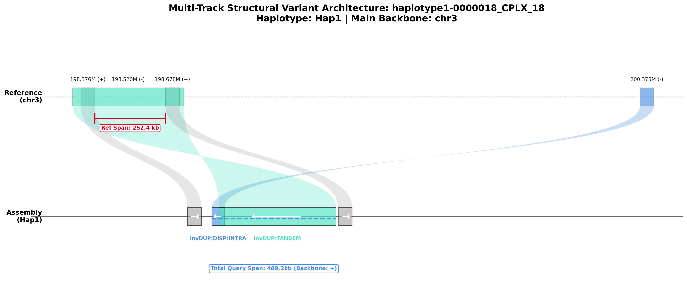
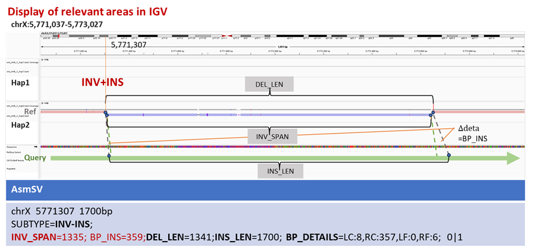

# Hierarchical VCF Format — Complex Rearrangement Records

This document specifies the hierarchical VCF record layout that AsmSV emits for **complex rearrangement regions (CRRs)**. A CRR is a locus in which a single assembly read carries two or more branch ("orphan") alignment clusters between flanking backbone breakpoints; AsmSV represents such a locus with a set of linked VCF records rather than a single flat record.

The same layout also covers the **INV composite variant** fields (`INV_SPAN`, `BP_DETAILS`, `BP_DEL`, `BP_INS`) used to annotate inversion-with-flanking-indel events.

> Companion reference for SVTYPE / FILTER / genotype conventions: see the [project README](../README.md#output-format).

---

## 1. Record Naming and Shared Identifiers

All records belonging to one CRR share a global event identifier in the `EVENT` INFO field, of the form:

```
haplotype{1|2}-{read_index}_CPLX_{event_index}
```

Individual VCF record IDs follow the nomenclature:

```
{EVENT}_{record_class}_{sub_index}
```

| Token in ID | Meaning |
|-------------|---------|
| `EVENT` | Global event identifier shared by every record of the CRR |
| `record_class` | `SUMMARY`, `SPAN`, or `BND` (see §2) |
| `sub_index` | Per-class index; for BND pairs, the cluster index plus an `A`/`B` orientation tag (e.g. `_BND_0_A`) |
| `TAIL` | Reserved sub-index for the outer backbone-flanking BND pair that delimits the whole CRR (`_BND_TAIL_A` / `_BND_TAIL_B`) |

When the same CRR is supported by both haplotypes, cross-haplotype clustering merges the evidence into a single representative ID; the merged `EVENT` field then carries **comma-separated** event identifiers from each contributing haplotype (e.g. `EVENT=haplotype1-0000018_CPLX_18,haplotype2-0000137_CPLX_17`).

---

## 2. Hierarchical Record Classes

A CRR is encoded as three nested record classes.

### 2.1 `*_SUMMARY` — Macro Descriptor

One record per CRR, anchored at the left backbone breakpoint.

- **FILTER:** `COMPLEX` (when ≥2 branch clusters are enclosed by the backbone) or `EDGE_COMPLEX` (when the branch network sits before/after the backbone, at a read edge).
- **ID:** `{EVENT}_SUMMARY`
- **Role:** Macroscopic descriptor of the whole locus — total reference span deleted, total query span inserted, branch-cluster count, and a serialized topology trace (`SUB_SVS`).

### 2.2 `*_SPAN_*` — Per-Cluster Rearrangement Unit

One record per branch cluster inside the CRR.

- **ID:** `{EVENT}_SPAN_{i}`
- **SVTYPE:** `CSV`
- **Role:** Describes a single rearrangement unit: its `SUBTYPE`, source reference interval (`SRCREG`), and inserted query length (`INS_LEN`). For all span records, `DEL_LEN` is set to `0`; the reference loss is accounted for at the summary level.

### 2.3 `*_BND_*` — Breakend Pairs

Novel adjacencies between non-contiguous reference positions.

- **ID:** `{EVENT}_BND_{i}_{A|B}` for cluster-internal pairs; `{EVENT}_BND_TAIL_{A|B}` for the outer backbone-delimiting pair.
- **SVTYPE:** `BND`
- **Pairing:** Each breakend cross-references its partner through `MATEID`; the ALT allele encodes orientation per VCFv4.2 breakend grammar (e.g. `C]chr3:200399904]`, `T[chr3:198653274[T`).

### Hierarchy Diagram

```
{EVENT}_SUMMARY          (FILTER=COMPLEX/EDGE_COMPLEX, SUB_SVS topology trace)
   ├── {EVENT}_SPAN_0    (CSV, SUBTYPE=…, SRCREG=…)
   ├── {EVENT}_SPAN_1    (CSV, …)
   │
   ├── {EVENT}_BND_TAIL_A  ─┐  outer backbone breakpoints
   ├── {EVENT}_BND_TAIL_B  ─┘
   ├── {EVENT}_BND_0_A  ─┐  cluster 0 entry/exit
   ├── {EVENT}_BND_0_B  ─┘
   └── {EVENT}_BND_1_A  ─┐  cluster 1 entry/exit
       {EVENT}_BND_1_B  ─┘
```

---

## 3. Worked Example — `haplotype1-0000018_CPLX_18`

The CRR at `chr3:198,400,875` (EVENT = `haplotype1-0000018_CPLX_18`) is used as a representative example. The full record set, sorted by reference position, is:

```
#CHROM POS         ID                                        REF ALT  FILTER      INFO
chr3   198321810   haplotype1-0000018_CPLX_18_BND_TAIL_A     T   [chr3:198653274[T  PASS     SVTYPE=BND;END=198321810;CHR2=chr3;POS2=198653274;MATEID=…_BND_TAIL_B;EVENT=…_CPLX_18;TRA_TYPE=INTRA_CHR;STRANDS=-+;SUPPORT_H1=1;SUPPORT_H2=0;RNAMES=haplotype1-0000018  GT 1|0
chr3   198400875   haplotype1-0000018_CPLX_18_SUMMARY        C   <CSV>             COMPLEX  SVTYPE=CSV;END=198653274;SVLEN=489242;EVENT=…_CPLX_18;EVENTTYPE=COMPLEX_InvDUP:DISP:INTRA_InvDUP:TANDEM;SUBTYPE=COMPLEX;DEL_LEN=252399;INS_LEN=489242;ORPHAN_CLUSTERS=2;SUB_SVS=…;RNAMES=haplotype1-0000018  GT 1|0
chr3   198400875   haplotype1-0000018_CPLX_18_BND_0_A        C   C]chr3:200399904]  PASS     SVTYPE=BND;END=198400875;CHR2=chr3;POS2=200399904;MATEID=…_BND_0_B;EVENT=…_CPLX_18;TRA_TYPE=INTRA_CHR;STRANDS=+-;SOURCE=COMPLEX;SUPPORT_H1=1;SUPPORT_H2=0;RNAMES=haplotype1-0000018  GT 1|0
chr3   198400875   haplotype1-0000018_CPLX_18_SPAN_0         C   <CSV>             PASS     SVTYPE=CSV;END=198400875;SVLEN=45038;EVENT=…_CPLX_18;SRCREG=chr3:200350362-200399904;SUBTYPE=InvDUP:DISP:INTRA;DEL_LEN=0;INS_LEN=45038;SUPPORT_H1=1;SUPPORT_H2=0;RNAMES=haplotype1-0000018  GT 1|0
chr3   198400875   haplotype1-0000018_CPLX_18_SPAN_1         C   <CSV>             PASS     SVTYPE=CSV;END=198400875;SVLEN=418177;EVENT=…_CPLX_18;SRCREG=chr3:198321810-198718972;SUBTYPE=InvDUP:TANDEM;DEL_LEN=0;INS_LEN=418177;SUPPORT_H1=1;SUPPORT_H2=0;RNAMES=haplotype1-0000018  GT 1|0
chr3   198653274   haplotype1-0000018_CPLX_18_BND_TAIL_B     C   C]chr3:198321810]  PASS     SVTYPE=BND;END=198653274;CHR2=chr3;POS2=198321810;MATEID=…_BND_TAIL_A;EVENT=…_CPLX_18;TRA_TYPE=INTRA_CHR;STRANDS=+-;SUPPORT_H1=1;SUPPORT_H2=0;RNAMES=haplotype1-0000018  GT 1|0
chr3   198718972   haplotype1-0000018_CPLX_18_BND_1_B        C   ]chr3:200350362]C PASS     SVTYPE=BND;END=198718972;CHR2=chr3;POS2=200350362;MATEID=…_BND_1_A;EVENT=…_CPLX_18,haplotype2-0000137_CPLX_17;TRA_TYPE=INTRA_CHR;STRANDS=--;SOURCE=COMPLEX;SUPPORT_H1=1;SUPPORT_H2=1;RNAMES=haplotype1-0000018,haplotype2-0000137  GT 1|1
chr3   200350362   haplotype1-0000018_CPLX_18_BND_1_A        C   ]chr3:198718972]C PASS     SVTYPE=BND;END=200350362;CHR2=chr3;POS2=198718972;MATEID=…_BND_1_B;EVENT=…_CPLX_18,haplotype2-0000137_CPLX_17;TRA_TYPE=INTRA_CHR;STRANDS=--;SOURCE=COMPLEX;SUPPORT_H1=1;SUPPORT_H2=1;RNAMES=haplotype1-0000018,haplotype2-0000137  GT 1|1
chr3   200399904   haplotype1-0000018_CPLX_18_BND_0_B        A   [chr3:198400875[A PASS     SVTYPE=BND;END=200399904;CHR2=chr3;POS2=198400875;MATEID=…_BND_0_A;EVENT=…_CPLX_18;TRA_TYPE=INTRA_CHR;STRANDS=-+;SOURCE=COMPLEX;SUPPORT_H1=1;SUPPORT_H2=0;RNAMES=haplotype1-0000018  GT 1|0
```

> The example carries two branch clusters (`InvDUP:DISP:INTRA` and `InvDUP:TANDEM`); the `*_BND_1_*` pair is merged across haplotypes (`SUPPORT_H1=1;SUPPORT_H2=1;GT=1|1`), so its `EVENT` and `RNAMES` fields list both contributing read groups.

The CRR topology (Ref vs Assembly 2D layout) generated by `scripts/plot.py` is shown below.



---

## 4. INFO Field Reference

### 4.1 Standard & Support Fields

| Field | Type | Description |
|-------|------|-------------|
| `SVTYPE` | String | Variant type (`DEL`, `INS`, `DUP`, `INV`, `BND`, `TRA`, `CSV`). |
| `SVLEN` | Integer | Signed length difference between REF and ALT alleles; negative for deletions. |
| `END` | Integer | End position on the reference (1-based, inclusive); equals `POS` for breakends. |
| `SUPPORT_H1` | Integer | Number of supporting assembly read groups from Haplotype 1 after cross-haplotype clustering. |
| `SUPPORT_H2` | Integer | Number of supporting assembly read groups from Haplotype 2 after cross-haplotype clustering. |
| `RNAMES` | String | Comma-separated names of the supporting assembly query sequences. |
| `SOURCE` | String | Detection layer: `backbone` (collinear split-read gap), `CIGAR` (single-segment CIGAR INDEL), `CIGAR_MERGED` (merged adjacent CIGAR INDELs), `COMPLEX` (branch cluster inside the backbone gap), `COMPLEX_EDGE` (edge branch cluster outside the backbone). |

### 4.2 Breakend Mate Fields (BND / TRA)

| Field | Type | Description |
|-------|------|-------------|
| `MATEID` | String | ID of the partner breakend record in a BND pair (VCFv4.2). |
| `CHR2` | String | Chromosome of the mate breakend. |
| `POS2` | Integer | 1-based reference position of the mate breakend. |
| `TRA_TYPE` | String | Breakend scope: `INTRA_CHR` (both breakpoints on the same chromosome) or `INTER_CHR` (breakpoints on different chromosomes). |
| `STRANDS` | String | Orientation of the two breakends, encoded as the joined strands of the mate pair (e.g. `+-`, `-+`, `--`). |

### 4.3 CSV Decomposition Fields

| Field | Type | Description |
|-------|------|-------------|
| `SUBTYPE` | String | Mechanistic subclass. Linear: `DUP:TANDEM`, `MULTI_DUP:TANDEM`, `INS_DEL`. Inversion-related: `INV`, `INV-INS`, `INV-DEL`, `INV-INS-DEL`, `InvDUP`, `InvDUP:TANDEM`, `InvDUP:PROXIMAL`, `InvDUP:DISP:INTRA`. Dispersed duplication: `DUP:PROXIMAL`, `DUP:DISP:INTRA`, `DUP:DISP:INTER`. Other: `LOCAL_RETAIN`, `COMPLEX` (summary records). |
| `EVENTTYPE` | String | Mechanism label on `*_SUMMARY` records: the single branch-cluster subtype, or `COMPLEX_<subtype1>_<subtype2>_…` for multi-cluster events. |
| `DEL_LEN` | Integer | Length (bp) of reference sequence deleted or replaced at this locus. |
| `INS_LEN` | Integer | Length (bp) of novel sequence inserted at this locus (query-derived). |
| `SEQ` | String | Inserted sequence. For `INS` records placed in the ALT column when below the length threshold; for `CSV(INS_DEL)` records placed in INFO. |

### 4.4 Event Linkage & Topology Fields

| Field | Type | Description |
|-------|------|-------------|
| `EVENT` | String | Shared event identifier linking the records of one CRR. Comma-separated when merged across haplotypes/clusters. |
| `ORPHAN_CLUSTERS` | Integer | Number of branch (orphan) alignment clusters in a `*_SUMMARY` record. |
| `MERGED_BLOCKS` | Integer | Number of adjacent alignment blocks merged into one nested linear SV within a branch network. |
| `SRCREG` | String | Reference interval of the inserted or duplicated source sequence (`chr:start-end`). |
| `SUBREGS` | String | Comma-separated reference sub-intervals (`start-end`) when the source region is fragmented across multiple branch alignment blocks; chromosome is that of `SRCREG`. |
| `SUB_SVS` | String | Pipe-separated topology trace on `*_SUMMARY` records (see §5). |

### 4.5 Inversion & Tandem-Duplication Detail Fields

| Field | Type | Description |
|-------|------|-------------|
| `INV_SPAN` | Integer | Length (bp) of the inner inverted segment on the reference (`inv_end − inv_start`). |
| `BP_DETAILS` | String | Inversion flanking gap metrics at the outer backbone breakpoints: `LC`/`RC` = left/right query gaps (bp) between backbone and inverted branch; `LF`/`RF` = left/right reference gaps (bp) between the outer breakpoints and the inverted-segment boundaries. |
| `BP_DEL` | Integer | Net reference sequence loss (bp) at inversion flanking breakpoints; present only when flanking deletions exceed `--min-sv`. |
| `BP_INS` | Integer | Net inserted sequence length (bp) at inversion flanking breakpoints; present only when flanking insertions exceed `--min-sv`. |
| `TANDEM_SOURCE` | String | Reference interval of the template region for a tandem duplication or short tandem insertion (`chr:start-end`). |

---

## 5. `SUB_SVS` Topology Trace

The `SUB_SVS` INFO field on `*_SUMMARY` records stores the metadata required to reconstruct and visualize the CRR topology. It is a pipe-separated list of tuples with the format:

```
{label},{chr},{ref_start},{ref_end},{query_start},{query_end},{strand}
```

| Field | Meaning |
|-------|---------|
| `label` | `backbone` for the first entry; otherwise the branch-cluster `SUBTYPE` |
| `chr` | Reference chromosome of the segment |
| `ref_start` / `ref_end` | Reference coordinates spanned by the segment |
| `query_start` / `query_end` | Query (assembly) coordinates spanned by the segment |
| `strand` | `+` or `−` |

Conventions:

1. The **first entry is always the flanking backbone anchor** (`label=backbone`).
2. All subsequent entries are ordered by **increasing query coordinate**.
3. A `−` strand entry denotes a reverse-orientation branch (inverted relative to the backbone).

Example (truncated from §3):

```
SUB_SVS=backbone,chr3,198400875,198653274,198148856,198638098,+|
         InvDUP:DISP:INTRA,chr3,200350362,200399904,198186338,198231376,-|
         InvDUP:TANDEM,chr3,198321810,198718972,198211879,198630056,-
```

---

## 6. Cross-Haplotype Merging

When both haplotypes support the identical complex structural variant, a clustering step merges the supporting evidence into a single representative record. The merge preserves provenance by:

- **Concatenating** the contributing `EVENT` identifiers in the merged record's `EVENT` field (comma-separated).
- **Concatenating** the contributing assembly read names in `RNAMES` (comma-separated).
- **Summing** per-haplotype support counts into `SUPPORT_H1` and `SUPPORT_H2`, and emitting the corresponding phased genotype (`1|1` in the diploid case).

This is illustrated by the `*_BND_1_*` pair in §3, which is supported by both `haplotype1-0000018` and `haplotype2-0000137` and therefore carries `GT 1|1`.

---

## 7. INV Composite Variant Fields

For inversion events that carry flanking indels (`SUBTYPE` = `INV-INS`, `INV-DEL`, or `INV-INS-DEL`), AsmSV annotates the breakpoint-level geometry with the inversion detail fields of §4.5.

The `chrX:5,771,307` variant from the HG002 ONT dataset is used as the reference example; its annotation schema is summarized below and visualized in the accompanying figure.

| Field | Meaning in an INV composite event |
|-------|-----------------------------------|
| `INV_SPAN` | Reference span of the inverted segment (`inv_end − inv_start`). |
| `INS_LEN` | Net query sequence alteration within the branch interval bounded by the flanking backbone breakpoints. |
| `DEL_LEN` | Net reference sequence alteration within the same branch interval. |
| `BP_DETAILS` | Left/right query gaps (`LC`, `RC`) and left/right reference gaps (`LF`, `RF`) at the outer backbone breakpoints; the net inserted length can be derived from these gaps. |
| `BP_DEL` | Net reference loss at the flanking breakpoints (only when exceeding `--min-sv`). |
| `BP_INS` | Net inserted sequence length at the flanking breakpoints (only when exceeding `--min-sv`). |



---

## 8. Visualization

Use `scripts/plot.py` to render the 2D topology (Reference vs Assembly) of any `*_SUMMARY` record from its `SUB_SVS` field. Requires `matplotlib`.

```bash
# List plottable COMPLEX events
python scripts/plot.py -i results.vcf --list

# Plot one event
python scripts/plot.py -i results.vcf -e haplotype1-0000018_CPLX_18 --hap Hap1 -o out.png
```

Example outputs are stored under `plots/` in the repository root.
